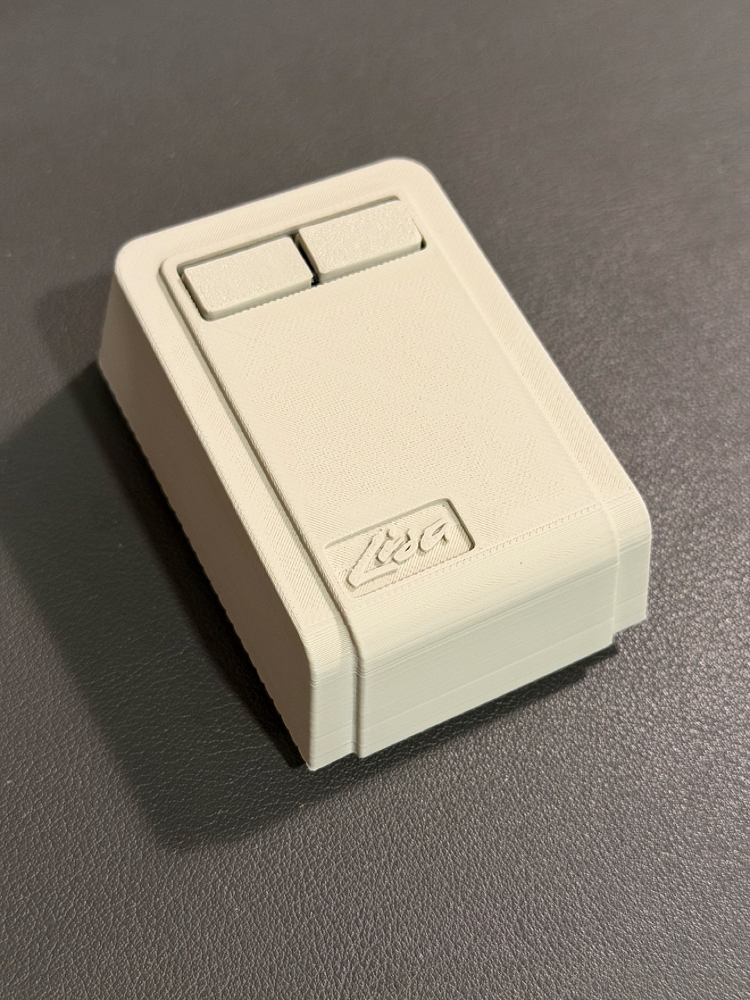

# Lisa Mouse — Logitech M185 conversion

A 3D-printed shell that turns a **Logitech M185** wireless mouse into a replica of the
**Apple Lisa mouse**. The M185's guts (PCB, sensor, switches, scroll wheel, battery) are
reused; the printed parts replace the stock case. Unlike the original one-button Lisa
mouse, this one has **two buttons**.



## What you need

| Item | Notes |
|------|-------|
| Logitech M185 wireless mouse | Donor for the electronics. |
| 3D printer + PLA | Parts fit a 0.4 mm nozzle; see [docs/PRINTING.md](docs/PRINTING.md). |
| Small Phillips screwdriver | For the M185's own screws. |
| 1 × AA battery | Alkaline AA. |
| PTFE mouse slides (optional) | Self-adhesive pads on the underside for smoother gliding; use any you like. |
| M3 screws | 1 × M3×4 flat head (PCB), 2 × M3×6 countersunk (button retainer), 2 × M3×8 countersunk (case); see [docs/ASSEMBLY.md](docs/ASSEMBLY.md). |


## Printed parts

STL files are in [`models/`](models/). Dimensions are the bounding box in the model's
design orientation (X × Y × Z, mm).

| File | Qty | Size (mm) | Purpose |
|------|:---:|-----------|---------|
| `base.stl` | 1 | 57.7 × 84.8 × 18.1 | Bottom plate; holds the M185 board and battery. |
| `top_shell.stl` **or** `top_shell_lisa_logo.stl` | 1 | 62.2 × 91.7 × 31.1 | The Lisa-style upper shell. The `_lisa_logo` variant has an embossed "Lisa" wordmark on top; the plain one is smooth (the photos also show it with an Apple logo decal). |
| `left_button.stl` | 1 | 20.1 × 27.1 × 23.9 | Left button. |
| `right_button.stl` | 1 | 23.9 × 27.1 × 19.5 | Right button. |
| `button_stop.stl` | 1 | 35.6 × 16.1 × 3.9 | Retainer plate that holds both buttons in the top shell. |
| `on_off_button.stl` | 1* | 12.0 × 7.2 × 6.0 | Power switch actuator, slides in the base to operate the M185 power switch. |
| `battery_cover_1.stl` | 1 | 14.7 × 53.1 × 8.9 | Battery door (main plate). |
| `battery_cover_2.stl` | 1 | 7.5 × 11.8 × 6.2 | Battery door (latch piece). |

\* The supplied slicer projects print two, one that is slightly taller that fit better for me; only one is used in the build. Use the one that slides better when the PCB is screwed down.

Part previews are in [`images/`](images/).

## Build it

1. **Print** the parts — [docs/PRINTING.md](docs/PRINTING.md)
2. **Assemble** — [docs/ASSEMBLY.md](docs/ASSEMBLY.md)

## Repository layout

```
models/     Print-ready STLs (one per part)
print/      Slicer projects with plate layout, orientation and settings
            (Bambu Studio / Bambu Lab A1, Creality Print / K2 Plus)
docs/       Printing and assembly instructions
images/     Part previews and slicer plate previews
scripts/    build_models.py — regenerates models/ and images/ from the source OBJ/STL export
```

## License

[CC BY-NC-SA 4.0](LICENSE) — share and adapt with attribution, non-commercially, under the same license.
