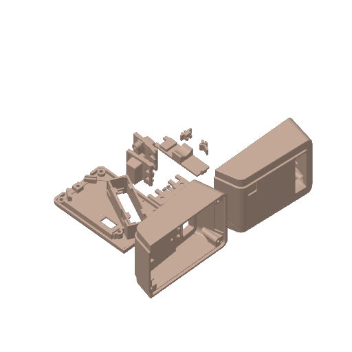
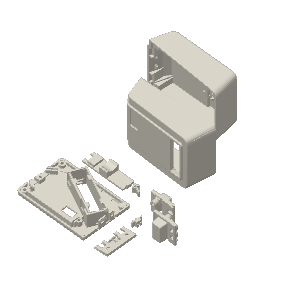
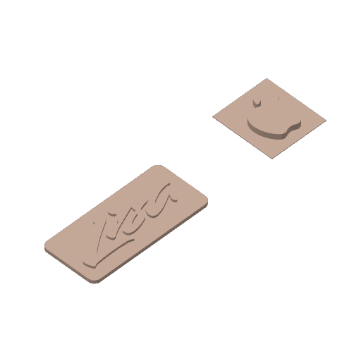
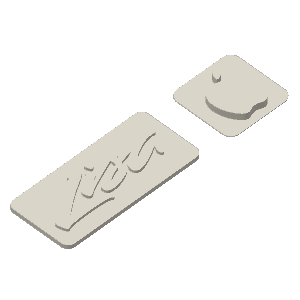

# Printing

## Settings used

These come from the slicer projects in [`print/`](../print/) and were used for the
v2 build.

| Setting | Value |
|---------|-------|
| Printers | Bambu Lab A1 (Bambu Studio), Creality K2 Plus (Creality Print) |
| Nozzle | 0.4 mm |
| Layer height | 0.20 mm (first layer 0.20 mm) |
| Walls | 2 |
| Top / bottom layers | 5 / 3 |
| Infill | 15 %, grid |
| Supports | Tree (auto), 30° threshold; supports painted on by hand for the top shells (see below) |
| Brim | Auto |
| Seam | Aligned |
| Material | PLA (PolyTerra PLA used for the prototype) |
| Nozzle / bed temp | 220 °C; bed 65 °C (Bambu A1), 50 °C (Creality K2 Plus) |
| Bed | Textured PEI |

Any FDM printer with roughly a 100 × 100 mm bed can print every part.

**Which top shell:** on an FDM printer use `models/fdm/`: its side walls are straightened so the shell
prints standing on a side. On a resin printer use `models/resin/` instead: those shells keep the
original Lisa mouse's leaning side walls. Everything else is in `models/common/` either way. Orient and
support resin parts as your resin slicer suggests; the rest of this page is about FDM.

## Slicer projects

Open one of these rather than the bare STLs: they carry the **print orientation**,
supports and plate arrangement (with the FDM shells). The STLs in `models/` are in design orientation and need
to be laid out by you if you slice them directly.

| Project | Slicer |
|---------|--------|
| [`print/LisaMouse_BambuStudio_A1.3mf`](../print/LisaMouse_BambuStudio_A1.3mf) | Bambu Studio |
| [`print/LisaMouse_CrealityPrint_K2Plus.3mf`](../print/LisaMouse_CrealityPrint_K2Plus.3mf) | Creality Print |

Both projects hold the v2 parts and are split into **two plates**:

| Plate | Contents | Bambu A1 | Creality K2 Plus |
|-------|----------|----------|------------------|
| 1 (*Main mouse parts* / *Pick One Top Shell*) | Base, both top shells, both buttons, button retainer plate, battery covers 1 and 2, on/off button |  |  |
| 2 (*Logo Plates* / *Logo Badges*) | Lisa logo plate and an Apple logo badge |  |  |

> **Notes**
> - Plate 1 holds both top-shell variants (Lisa recess and Apple recess). Print only one: delete or
>   disable the other before slicing.
> - Print only the logo plate that matches your shell.
> - Each project has one on/off button. The Creality project uses a slightly smaller variant than
>   `models/common/on_off_button.stl`; use whichever slides better when the PCB is screwed down.

## Part-by-part orientation

### Base
Prints flat on the bed. No supports needed.

### Buttons
Two options:

- **Fewer supports:** lay the button on the bed with its **inside surface facing in**
  (toward the bed side that needs the least support). Easiest, with slightly less polished
  top surface.
- **Best top surface:** print with the **button top face down** on the bed, with supports.
  The top surface gets the support-free first-layer finish.

### Top shell (the hard part)
Pick one, in order of finish quality:

1. **Resin print (recommended).** Order it from a print service such as
   [JLC3DP](https://jlc3dp.com) in resin. This gives the best surface with no support
   scarring, and avoids all of the issues below.
2. **Top face down** (dual extruder / multi-material printer with a separate support
   filament, e.g. soluble or breakaway). The top is printed flat on the bed and the
   overhanging interior is supported with a dedicated support material for good overhang
   quality.
3. **Top face up** (single-material FDM). To get the best finish, the top surface is kept
   **level**: only one small line at the front of the mouse touches the bed, and the
   sloped bottom angles up and away from the bed, so it needs supports.
   - The inside of the shell was designed as level as possible so a **support interface**
     needs few filament changes.
   - Because the underside is sloped, expect **many filament changes early in the print**
     if you use a separate support-interface filament.

4. **On its side** (single-material FDM, v2 shell). The side walls are vertical, flat and
   parallel, so the shell can stand on either side. The top surface is then built from layer
   edges instead of resting on supports; the inside of the upper side wall needs supports.

> The top shells in the slicer projects are set up for option 4, **on their side**, with supports
> painted on by hand only where the inside needs them.

### Logo plates
Print the logo plate flat, show face up (the bevelled side is the back), and glue it into the recess in
the top shell. With a multi-colour printer, paint or split the plate in the slicer.

## Fit

- Parts that mate (buttons in the shell, covers on the base) are tight-tolerance. If your
  printer runs a little over-sized, test-fit the buttons first and sand lightly.
- The v2 buttons keep 0.35 mm from the shell everywhere except the hinge and the front edge of the
  flange, which is the stop when the button lifts. If a button still catches, see Step 14 in
  [ASSEMBLY.md](ASSEMBLY.md).
<!-- TODO(author): colour recommendations. -->
