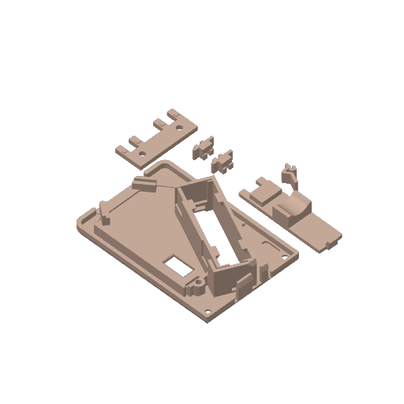
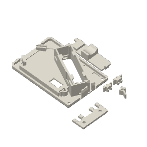
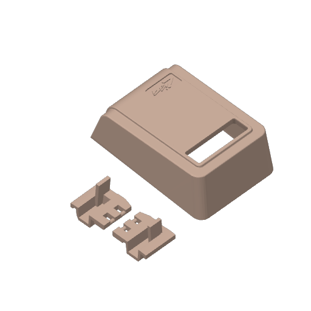
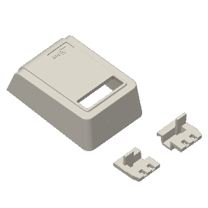
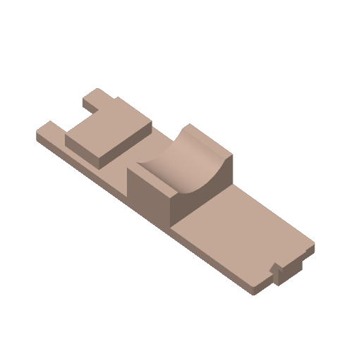
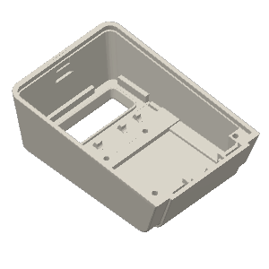

# Printing

## Settings used

These come from the slicer projects in [`print/`](../print/) and were used for the
prototype build.

| Setting | Value |
|---------|-------|
| Printers | Bambu Lab A1 (Bambu Studio), Creality K2 Plus (Creality Print) |
| Nozzle | 0.4 mm |
| Layer height | 0.20 mm (first layer 0.20 mm) |
| Walls | 2 |
| Top / bottom layers | 5 / 3 |
| Infill | 15 %, grid |
| Supports | Yes — tree (auto), 30° threshold |
| Brim | Auto |
| Seam | Aligned |
| Material | PLA (PolyTerra PLA used for the prototype) |
| Nozzle / bed temp | 220 °C / 65 °C |
| Bed | Textured PEI |

Any FDM printer with roughly a 100 × 100 mm bed can print every part.

## Slicer projects

Open one of these rather than the bare STLs: they carry the **print orientation**,
supports and plate arrangement. The STLs in `models/` are in design orientation and need
to be laid out by you if you slice them directly.

| Project | Slicer |
|---------|--------|
| [`print/LisaMouse_BambuStudio_A1.3mf`](../print/LisaMouse_BambuStudio_A1.3mf) | Bambu Studio |
| [`print/LisaMouse_CrealityPrint_K2Plus.3mf`](../print/LisaMouse_CrealityPrint_K2Plus.3mf) | Creality Print |

> **Note:** these projects were saved before the final `top_shell_v4` model and still
> reference the v3 top shell. Replace the shell object with `models/top_shell.stl` (or
> `top_shell_lisa_logo.stl`) and re-orient it as in the project (top surface up).
<!-- TODO(author): re-save the 3MFs with the v4 shell and remove this note. -->

### Plate layout

| Plate | Bambu A1 | Creality K2 Plus |
|-------|----------|------------------|
| 1 |  |  |
| 2 |  |  |
| 3 |  |  |

Bambu project: plate 1 = base, button stop, on/off buttons, battery cover 2;
plate 2 = top shell (logo) and buttons; plate 3 = battery cover 1.
Creality project: plate 1 = base, on/off buttons, battery covers, left button;
plate 2 = button variants and button stop; plate 3 = top shell (logo).

## Part-by-part orientation

### Base
Prints flat on the bed. No supports needed.

### Buttons
Two options:

- **Fewer supports:** lay the button on the bed with its **inside surface facing in**
  (toward the bed side that needs the least support). Easiest, with slightly less polished
  top surface.
- **Best top surface:** print with the **button top face down** on the bed, with supports.
  The top surface gets the support-free first-layer finish.

### Top shell (the hard part)
Pick one, in order of finish quality:

1. **Resin print (recommended).** Order it from a print service such as
   [JLC3DP](https://jlc3dp.com) in resin. This gives the best surface with no support
   scarring, and avoids all of the issues below.
2. **Top face down** (dual extruder / multi-material printer with a separate support
   filament, e.g. soluble or breakaway). The top is printed flat on the bed and the
   overhanging interior is supported with a dedicated support material for good overhang
   quality.
3. **Top face up** (single-material FDM). To get the best finish, the top surface is kept
   **level**: only one small line at the front of the mouse touches the bed, and the
   sloped bottom angles up and away from the bed, so it needs supports.
   - The inside of the shell was designed as level as possible so a **support interface**
     needs few filament changes.
   - Because the underside is sloped, expect **many filament changes early in the print**
     if you use a separate support-interface filament.

> The top shell orientation in the slicer projects is the "top face up, level top" setup.

## Fit

- Parts that mate (buttons in the shell, covers on the base) are tight-tolerance. If your
  printer runs a little over-sized, test-fit the buttons first and sand lightly.
<!-- TODO(author): add tolerance/fit findings (the 3MFs contain button clearance experiments of -0.4 / -0.3 / +0.2 mm) and colour recommendations. -->
